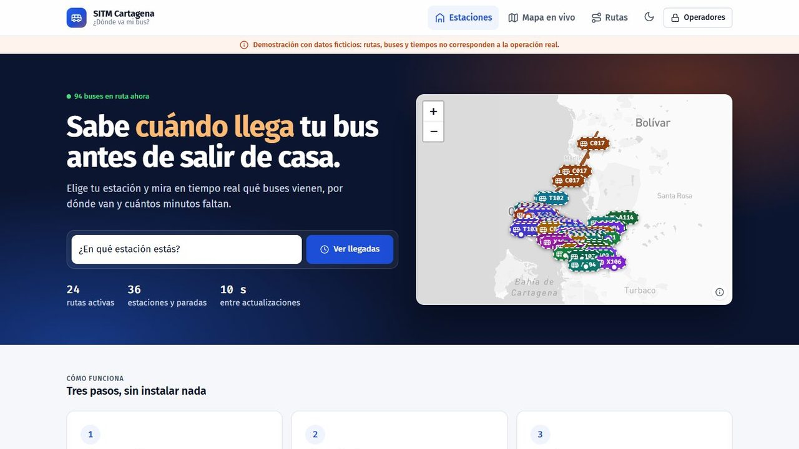
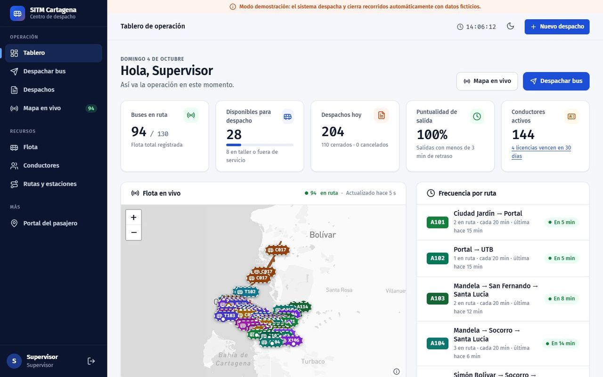
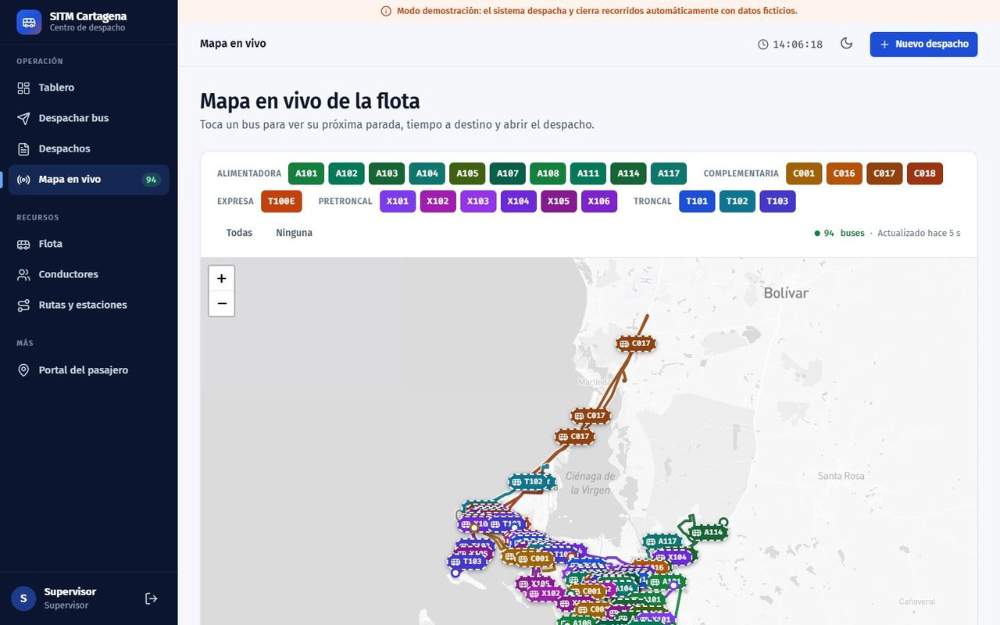
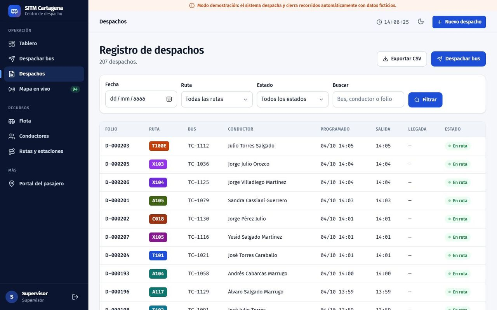
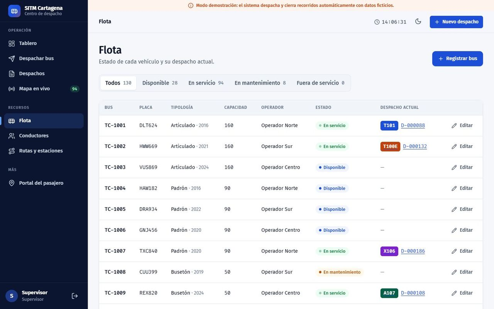
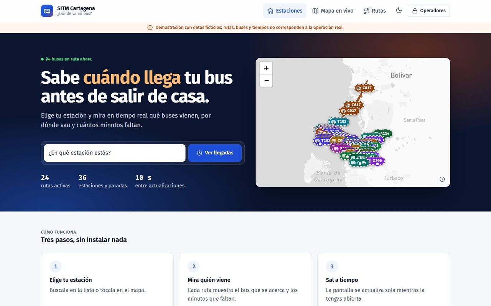
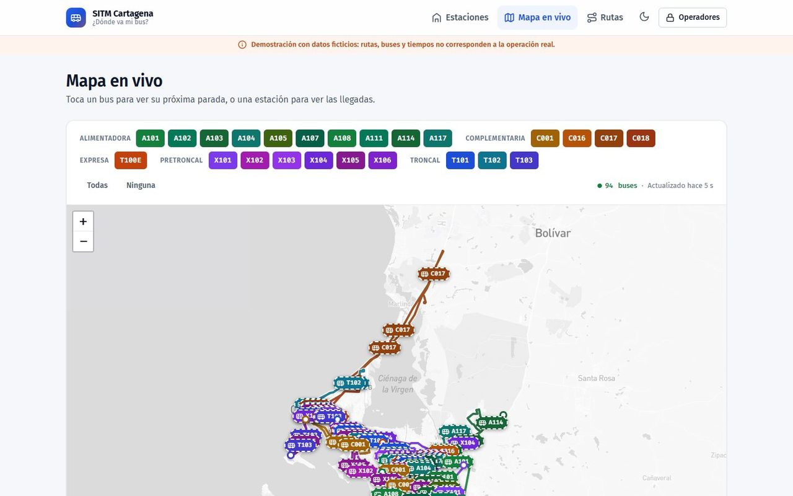
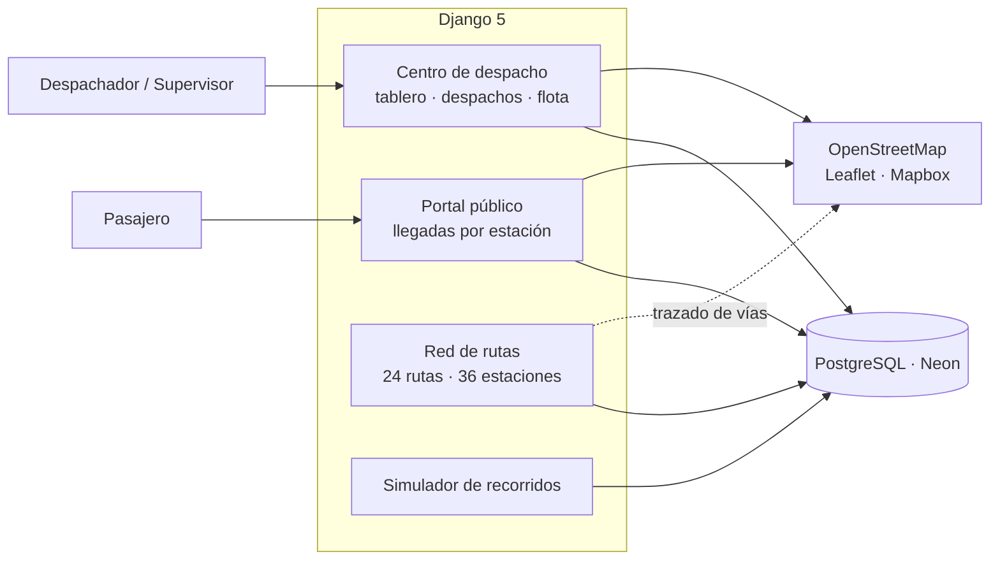

# 🚌 SITM Cartagena · Despacho de buses

**Centro de despacho para un sistema de transporte masivo**, con mapa en vivo de la flota y un portal para que el pasajero sepa cuándo llega su bus.

> 🔒 **Repositorio de presentación.** El código fuente es privado. Aquí encontrarás la descripción, la arquitectura y capturas del sistema. Si quieres conocer el código para un proceso de selección, [escríbeme](mailto:luisda3329@hotmail.com).

---

## 📌 Qué es

Aplicación que digitaliza el despacho de buses de un sistema integrado de transporte masivo en Cartagena y elimina el uso de papel en la operación:

- **Los despachadores** programan y despachan buses por ruta, controlan la flota y los conductores y siguen cada recorrido en un mapa en vivo.
- **Los pasajeros** consultan desde el celular qué buses vienen a su estación y en cuántos minutos, sin instalar nada.

Las 24 rutas están trazadas sobre las vías reales, y un modo demostración simula los buses en movimiento con tiempos de recorrido realistas.

## ✨ Funcionalidades

- 📊 **Tablero de operación:** buses en ruta, puntualidad, frecuencia por ruta y conductores con licencia por vencer.
- 🚦 **Despacho** con validación de bus y conductor disponibles, inicio, novedades y cierre del recorrido.
- 🗺️ **Mapa en vivo** con la flota moviéndose sobre 24 rutas y 36 estaciones trazadas con datos de OpenStreetMap.
- 📱 **Portal del pasajero** con llegadas estimadas por estación, actualizado cada pocos segundos.
- 🚌 **Gestión de flota y conductores;** registro de despachos con filtros y exportación CSV.
- 🔐 Roles de supervisión y despacho, política CSP estricta, límite de intentos de inicio de sesión y base de datos en Neon.

## 🖼️ Capturas

| | |
|---|---|
|    **Tablero de operación** del despacho |    **Mapa en vivo** de la flota por ruta |
|    **Registro de despachos** con filtros |    **Estado de la flota** |
|    **Portal del pasajero** |    **Mapa público** en vivo |

## 🏗️ Arquitectura

## 🛠️ Stack

---

Hecho por **[Luis Mercado](https://github.com/luismercado29)** · Desarrollo full-stack · Proyecto académico rediseñado en 2026

© 2026 Luis Mercado. Todos los derechos reservados.

